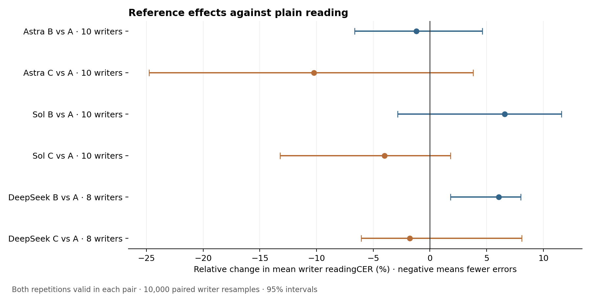

# Source-reference extraction on ten HWR200 writers

This study tests whether handwriting examples extracted from a separate document by the same writer reduce character errors on complete held-out documents. It uses ten modern Russian writers, three readers and two fresh reader repetitions per condition. Study date: **15 November 2026, Dubai**.

**No reference condition establishes an improvement over plain reading on this sample.** Every paired reference-versus-plain interval includes zero, except raw-source references for DeepSeek, where errors increase. Dataset-assisted extraction has lower point estimates than plain reading for all three readers, but the uncertainty is wide. Sol improves with assisted references compared with raw references; that comparison does not establish a gain over plain reading.

## All planned inference runs were attempted; DeepSeek has six failures

Each run covers one complete target document. A failed API response is excluded from CER and remains a failure in coverage. It is never replaced by a guessed score or a paid retry.

| Reader | Valid document runs / planned | Valid target-page transcriptions / planned | Writers with both repetitions valid in all three conditions |
|---|---:|---:|---:|
| Astra (`gpt-6-astra`) | 60 / 60 | 270 / 270 | 10 |
| Sol (`gpt-6.1-sol`) | 60 / 60 | 270 / 270 | 10 |
| DeepSeek (`deepseek-flash`) | 54 / 60 | 245 / 270 | 7 |
| Russian CRNN | 10 / 10 | 45 / 45 | Single frozen pass |

DeepSeek failures are three pre-response DNS failures for writer017, two responses that return the reference examples instead of targets for writer025 condition C, and one output-token truncation for writer026 condition B. Exact raw responses and failure records are preserved.

## Reference effects remain uncertain against plain reading

Conditions are **A: plain transcription**, **B: references extracted from source scans only**, and **C: references extracted from the same source scans plus their published source text**. No reading skill is supplied in any condition.

Character error rate (CER) is character edit distance divided by the reference character count, after the specified normalization. Each document joins all target pages in numeric order. Repetitions are averaged within writer before comparison. The table below uses only writers with **both planned repetitions valid in each compared condition**. Wins/ties/losses count writers, not pages or repetitions. Negative relative change means fewer errors. Intervals use 10,000 paired resamples of writers, seed 20261115; no correction for multiple comparisons is applied.

| Reader | Comparison | Paired writers | Relative change in mean writer readingCER, 95% interval | Wins / ties / losses |
|---|---|---:|---:|---:|
| Astra | B vs A | 10 | -1.20% [-6.64%, +4.61%] | 5 / 0 / 5 |
| Astra | C vs A | 10 | -10.24% [-24.78%, +3.81%] | 6 / 2 / 2 |
| Astra | C vs B | 10 | -9.15% [-23.05%, +3.16%] | 7 / 0 / 3 |
| Sol | B vs A | 10 | +6.61% [-2.84%, +11.61%] | 4 / 0 / 6 |
| Sol | C vs A | 10 | -3.99% [-13.21%, +1.80%] | 6 / 0 / 4 |
| Sol | C vs B | 10 | -9.94% [-15.79%, -0.19%] | 7 / 0 / 3 |
| DeepSeek | B vs A | 8 | +6.08% [+1.81%, +8.01%] | 1 / 1 / 6 |
| DeepSeek | C vs A | 8 | -1.79% [-6.06%, +8.09%] | 5 / 0 / 3 |
| DeepSeek | C vs B | 7 | -2.39% [-8.63%, +7.74%] | 4 / 0 / 3 |

The isolated Sol C-versus-B result favors assisted extraction. The C-versus-A comparisons do not establish a benefit over plain reading for Astra, Sol or DeepSeek. These results support no general accuracy claim for either reference workflow.

## Absolute error rates use the available valid repetitions

Cells show **mean writer CER / pooled CER**, both as percentages. The mean gives each writer equal weight; pooled CER sums the within-writer average edit counts and divides by summed reference character counts. These are whole-document results on published labels. Astra, Sol and CRNN cover ten writers. DeepSeek A/B cover ten writers with incomplete repeat counts; C covers nine and entirely omits writer025. **Those unmatched DeepSeek column averages must not be interpreted as a reference benefit.** The paired table above uses stricter, matched populations.

| readingCER | A | B | C |
|---|---:|---:|---:|
| Astra | 1.390 / 1.327 | 1.373 / 1.314 | 1.248 / 1.202 |
| Sol | 2.608 / 2.497 | 2.780 / 2.651 | 2.504 / 2.376 |
| DeepSeek | 19.717 / 18.574 | 19.265 / 18.373 | 16.955 / 15.930 |
| Russian CRNN | 11.543 / 11.364 | — | — |

readingCER applies NFC, casefolding, Unicode punctuation removal and whitespace collapse; **ё remains distinct from е**. Unknown markers are charged as output, not excluded.

| literalCER | A | B | C |
|---|---:|---:|---:|
| Astra | 2.153 / 2.087 | 2.145 / 2.081 | 2.074 / 2.026 |
| Sol | 3.438 / 3.334 | 3.620 / 3.489 | 3.297 / 3.173 |
| DeepSeek | 20.838 / 19.710 | 20.230 / 19.360 | 18.229 / 17.197 |
| Russian CRNN | 12.823 / 12.603 | — | — |

literalCER applies NFC and whitespace collapse while retaining case and punctuation. Full per-writer edit counts, repeats, availability and both metrics are in [metrics.json](metrics.json) and [per-writer-CER.csv](per-writer-CER.csv).

## Source and target evidence were kept separate

The fixed writers are 17, 18, 20, 21, 22, 23, 24, 25, 26 and 28. Each group contains a complete source FPR document and a separate complete original target document: **57 source scans and 45 target scans**. All 102 native files decode and match their recorded hashes; there are no shared image hashes between source and target roles. Nine source/target text pairs share no exact eight-word sequence; writer023 shares one. Shorter common phrases and pretraining exposure are not excluded. No writer was replaced after recognition or selected by score.

Each source condition uses a fresh Astra extraction context and the same frozen [extractor snapshot](skill-snapshots/extract-handwriting-references.md). Every source page is surveyed. Each condition permits at most 24 clear examples; actual totals are **154 B crops and 142 C crops**. Every retained native PNG was visually inspected by its extractor and independently matched pixel-for-pixel to its source coordinates. All labels remain `provisional` or `dataset-assisted-provisional`; none is called human-confirmed.

One labelled JPEG sheet and one selected-label JSON file are frozen per writer/condition. Sheets meet 1600×2400 and 1 MiB bounds. Every reader uses the same sheet bytes and selected labels for its condition. Native crops and complete source text are not extra reader inputs. This tests fixed Astra-extracted references across readers; it does not compare each reader’s own extraction workflow or estimate extraction-repeat variance.

## Native input files were fixed; host processing differs

Astra and Sol use fresh contexts per writer, condition and repetition. The allowance is one initial original-image request plus at most two extra requests per page. All target pages were reported fully displayed; host resizing and scan-edge clipping remain in per-page records. Three extra request attempts are recorded: one mistyped-path failure, one additional Astra view and one additional Sol view, all for writer025 and within budget. No thumbnail/strip display failure was observed. Targets were not resized, cropped or changed by the coordinator.

DeepSeek receives the original target bytes once per independent API request plus the optional reference sheet. It uses `detail=original`, thinking disabled, temperature 0 and 8192 output tokens. Encoded request sizes are checked against 48 MiB before each call. The configured model/host pipelines differ; within-reader reference contrasts are the direct controlled comparison. Requested/returned aliases are preserved, rather than inventing unexposed backend version identifiers. [Official vision documentation](https://api-docs.deepseek.com/guides/vision/) describes the API image settings.

## The conventional baseline covers every target page

The baseline is the frozen local Russian CRNN with Kraken blla segmentation, the same configuration used in the matched system-selection work. It uses native target files, axis-aligned line bounds, grayscale line images resized to 128 px height with aspect ratio preserved, and greedy CTC decoding. All 45 pages complete without a prediction failure. Exact package versions, checkpoint hashes, preprocessing and runner provenance are recorded in [baseline-settings.json](baseline-settings.json); the [public checkpoint source](https://huggingface.co/achimrabus/crnn-ctc-russian) is linked for reproduction.

Full matched Transkribus coverage is unavailable within authorized free credits; no credits were purchased. Rehand is not rerun here after service timeouts in system selection. The broader ready-system selection remains incomplete. This report makes no overall ready-system winner claim.

## Published labels and a small fixed writer sample limit the conclusion

Target documents and handwriting consistency were visually surveyed, and the evaluator audit was frozen before recognition. It flags copying differences, repeated wording and questionable labels. The audit is an assistant correspondence check, not exhaustive human proofreading. Primary labels stay exactly published; no assistant correction set is substituted or called human-verified. The score therefore measures agreement with published labels, which can differ from visible writing.

Ten deterministically selected modern writers and two reader repeats do not establish population-wide or historical-handwriting effects. Writer bootstrap intervals describe sensitivity to this sample and these fixed packets. They do not include extraction-repeat variability, hidden training overlap or a human ground-truth audit.

## Reproduction preserves model inputs and failures

[Download the data-only ZIP (142.2 MiB)](https://github.com/Minlos/handwriting-reference-library/releases/download/ten-writer-reference-extraction-2026-11-15/hwr200-ten-writer-reference-data-2026-11-15.zip). The checksum and entry count are in [data-archive.json](data-archive.json).

- [Public protocol](protocol.public.json), [frozen transcription prompt](reader-prompt.txt), [metrics](metrics.json), [failure records](deepseek-failures.json), [data archive checksum](data-archive.json), and [official source-packet review viewer](reference-packet-review.html). The viewer has 20 runs / 20 embedded sheets; browser preview was unavailable because the registered system default browser could not launch. No alternative browser was opened.
- The data-only ZIP contains originals, native crops, frozen sheets/labels, source/target manifests, evaluator labels, task inputs and immutable recognition outputs. Skill snapshots, this README and scripts stay outside the ZIP. Native image/sheet/selected-label/raw-output bytes are preserved; portable scripts resolve producing-workspace paths under the extracted root.
- Extract the data ZIP beside these files, then run `python score.py`, `python verify_metrics.py`, `python validate_predictions.py`, and `python validate_packets.py` (Pillow required). Scoring uses the exact frozen historical metric implementation. 300 independent distance checks and 368 CER numerator/denominator checks passed.
- CRNN replay requires the recorded packages and exact `russian-crnn.pt` hash; `run_htr.py` writes separate replay outputs. DeepSeek replay requires an environment key, an explicitly approved separate local budget, and `--execute`. The bundled budget example is zero; no account files or credentials are supplied. The portable helper matches the frozen content encoding and all 57 saved response/cost parses, tested without paid calls.

The public protocol omits only private ledger location, remaining shared approval and account-credit balances; it records the exact private execution-protocol SHA. The original protocol and all frozen snapshots remain unchanged in the producing workspace.

Known DeepSeek usage valued at conservative peak rates is **$0.143748744**; an additional **$0.12** remains reserved for the three no-response failures. The combined conservative commitment is **$0.263748744**, not an invoice. All 60 planned attempts fit the existing approval, with no paid retries or extra purchases. Astra/Sol host token costs are not exposed and are not fabricated. [Official pricing](https://api-docs.deepseek.com/quick_start/pricing/) supplies the peak rates.

Data source: [AntiplagiatCompany/HWR200](https://huggingface.co/datasets/AntiplagiatCompany/HWR200/blob/main/README.md), pinned revision `366a882a2b8d043d437126d2878bd3812ec55a94`, Apache-2.0. Dataset authors: Ivan Potyashin, Mariam Kaprielova, Yury Chekhovich, Alexandr Kildyakov, Temirlan Seil, Evgeny Finogeev and Andrey Grabovoy (2023). The archive includes the dataset licence.
